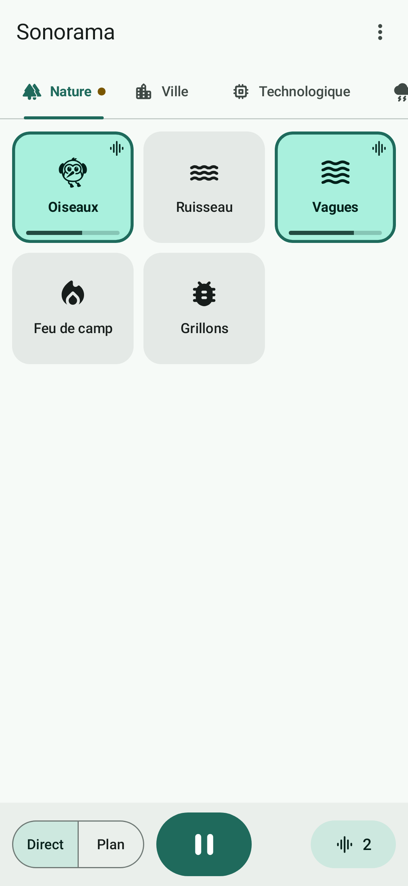
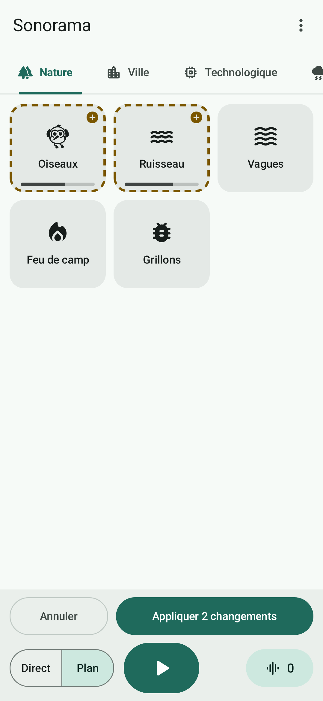
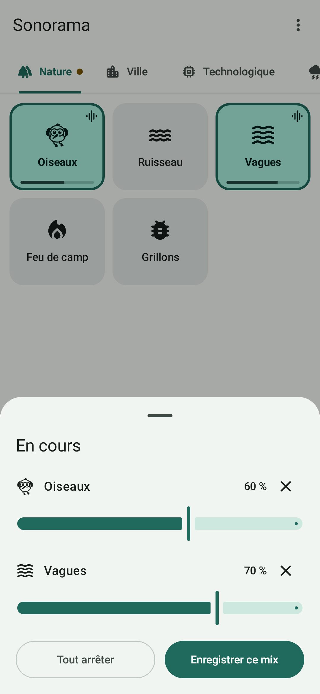
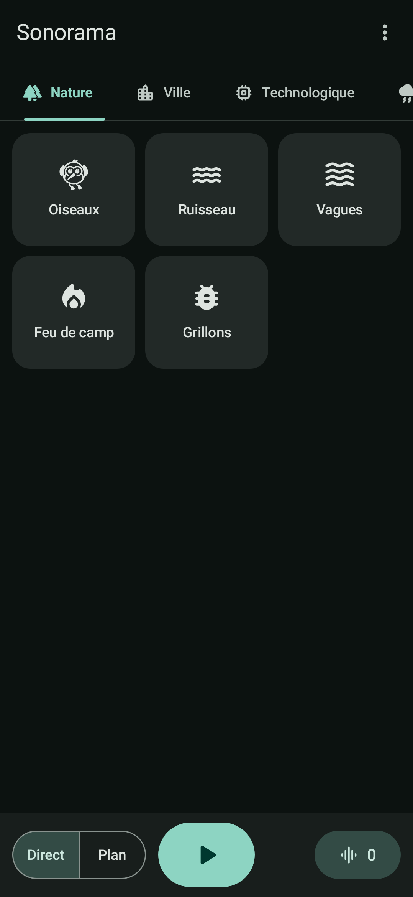

# Sonorama

[](LICENSE)

Sonorama est une appli Android qui joue des sons d'ambiance en boucle, mixés en direct depuis des pages de
cartes tactiles. Elle sert à lire des histoires aux enfants et à mener des parties de jeu de rôle : une grille
de cartes, un bouton play/pause, aucun compte, aucune publicité, aucun accès réseau.

<p>
  
  
  
  
</p>

## Ce que fait l'appli

- **Cartes** : un appui lance ou arrête un son, toujours en fondu. Jusqu'à 12 sons en même temps.
- **Mode plan** : les appuis préparent des changements sur plusieurs pages ; « Appliquer » les déclenche
  ensemble, en fondu croisé.
- **Volume par carte** : appui long, puis glissement vertical ; le niveau est mémorisé.
- **Play/pause général** : le mix s'éteint et reprend en fondu ; il est restauré en pause à la réouverture.
- **Arrière-plan** : lecture écran éteint, commandes dans la notification, sur l'écran verrouillé et au casque.
- **Pages personnalisées** : vos cartes favorites sur une page à vous, exportable en fichier.
- **Cartes composées et scènes** : plusieurs sons sous une seule carte, ou le mix en cours enregistré tel quel.
- **Packs de sons** : 24 boucles fournies, d'autres par fichiers ZIP importés depuis le téléphone.
- **Accessibilité** : TalkBack, grandes cibles tactiles, thèmes clair et sombre, français et anglais.

## État du projet

Le code couvre les lots 0 à 3 de la [spécification](docs/specification.md). Il compile, passe le lint et
32 tests automatisés, dont des tests d'écran qui pilotent l'appli réelle sur JVM.

**Il n'a pas encore tourné sur un téléphone.** Restent donc à valider sur appareil, avant toute publication :

- le raccord des boucles et la charge de 12 lecteurs sur un téléphone d'entrée de gamme (risque du lot 0) ;
- la lecture écran éteint pendant 2 h, la notification média et les commandes Bluetooth ;
- le geste de volume et le parcours TalkBack ;
- la qualité des 24 sons du pack de base, qui sont **synthétisés** et n'ont pas été écoutés ni comparés à
  des enregistrements.

Les points ouverts de la spécification (marque « Sonorama », pack de base enregistré) restent à traiter.

## Compiler

Prérequis : JDK 21 et SDK Android (plateforme 37). Avec Android Studio, ouvrez simplement le dossier.

```bash
./gradlew assembleDebug        # app/build/outputs/apk/debug/app-debug.apk
./gradlew testDebugUnitTest    # tests ; captures d'écran dans app/build/screens/
./gradlew lintDebug
./gradlew assembleRelease      # APK optimisé (environ 12 Mo), non signé
```

Le pack de base se régénère avec `python3 tools/generate_base_pack.py` (Python 3.10+, numpy, ffmpeg).

## Organisation du dépôt

| Chemin | Contenu |
| --- | --- |
| `app/src/main/kotlin/…/audio` | Moteur de mixage (`MixEngine`), lecteurs Media3, service de lecture |
| `app/src/main/kotlin/…/data` | Base Room, dépôt, réglages, import de packs, export de pages |
| `app/src/main/kotlin/…/ui` | Écrans Jetpack Compose et `MainViewModel` |
| `app/src/main/assets/basepack` | Pack de base : manifeste, 24 boucles Ogg, licences |
| `app/src/test` | Tests du moteur, des packs et des écrans |
| `tools/generate_base_pack.py` | Synthèse des boucles du pack de base |
| `docs/` | [Spécification](docs/specification.md), [plan de codage](docs/plan-de-codage.md), [format des packs](docs/format-pack.md) |
| `fastlane/metadata` | Fiche de l'appli pour F-Droid |

## Fabriquer un pack de sons

Un pack est une archive ZIP contenant un `manifest.json`, des boucles Ogg Vorbis et un `LICENSES.md`.
Le format est décrit dans [docs/format-pack.md](docs/format-pack.md) ; c'est aussi la voie pour ajouter
ses propres sons.

## Vie privée

Sonorama ne demande ni accès réseau ni accès au stockage. Ses seules permissions sont le service de premier
plan (lecture média), les notifications et le maintien du processeur éveillé pendant la lecture. Rien n'est
collecté, rien n'est envoyé.

## Contribuer

Voir [CONTRIBUTING.md](CONTRIBUTING.md) et le [code de conduite](CODE_OF_CONDUCT.md).
Les failles de sécurité se signalent en privé : [SECURITY.md](SECURITY.md).

## Licences

- Code : [GNU GPL 3.0](LICENSE).
- Sons du pack de base : [CC0 1.0](app/src/main/assets/basepack/LICENSES.md), créations originales synthétisées.
- Pictogrammes : Material Icons de Google, licence Apache 2.0.

---

**English summary.** Sonorama is an Android app that plays looping ambient sounds, mixed live from pages of
touch cards, for story time and tabletop role-playing games. No account, no ads, no network access. It is
written in Kotlin with Jetpack Compose and Media3, licensed under GPL-3.0, and available in French and English.
The code builds and its automated tests pass, but it has not yet been run on a physical device.
